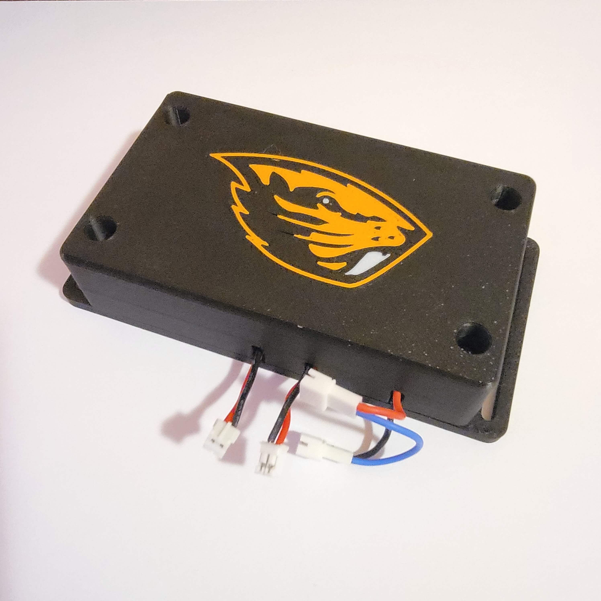
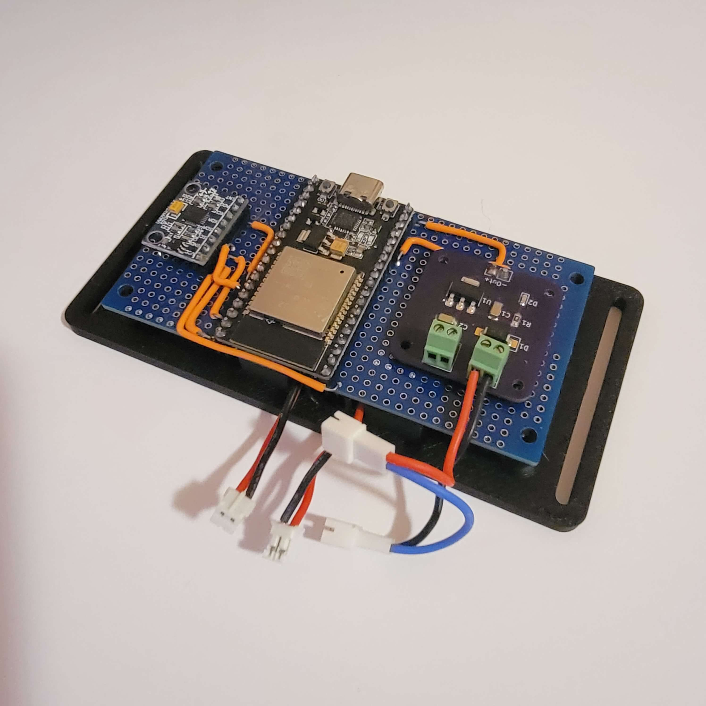
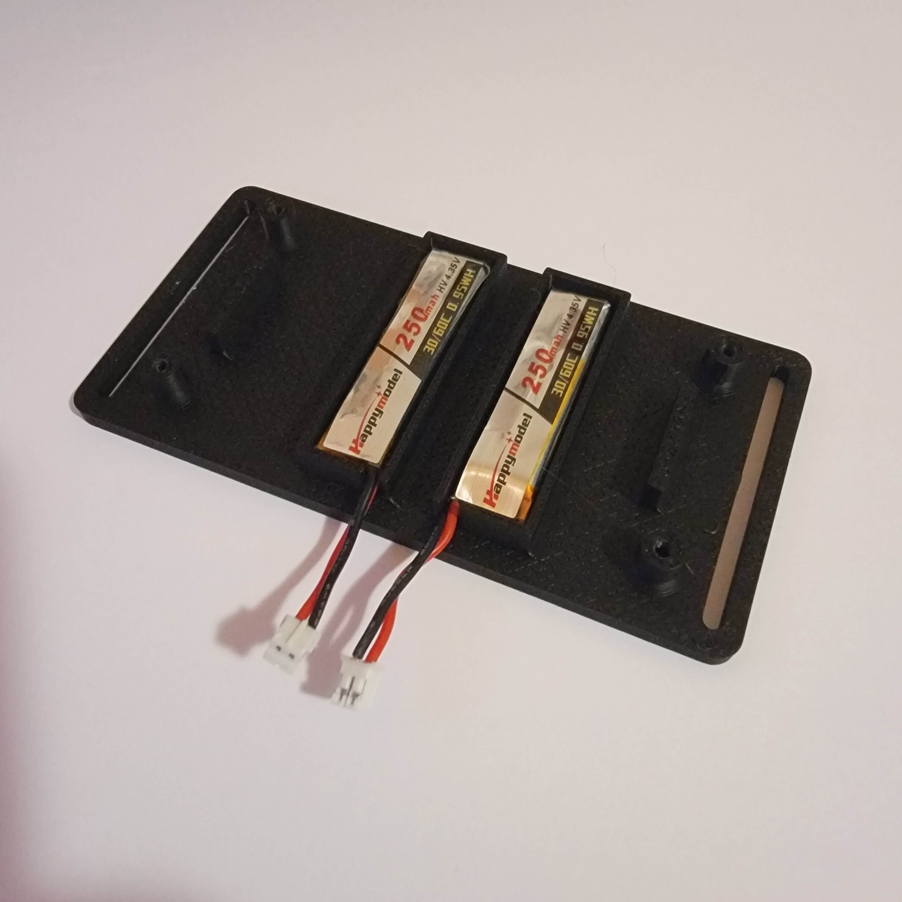
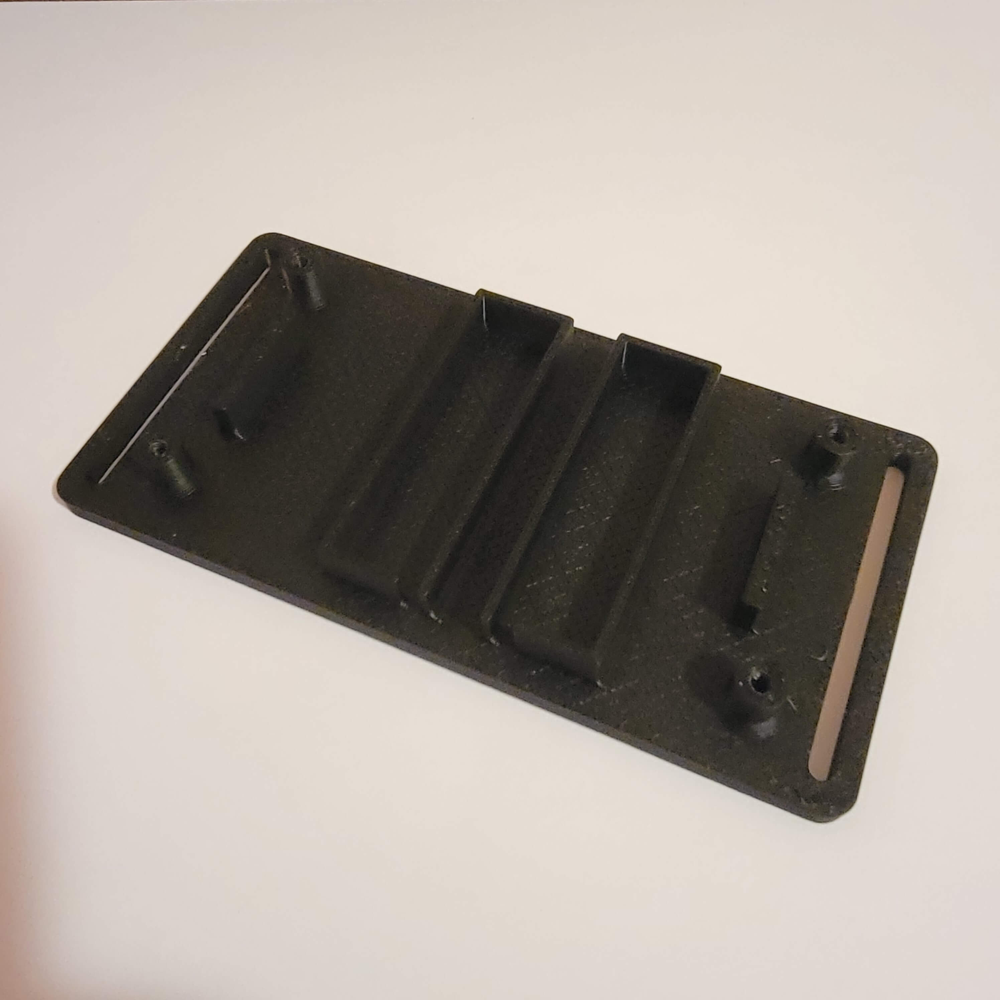
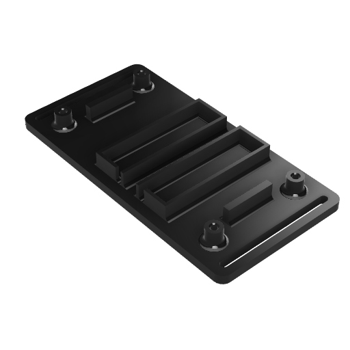
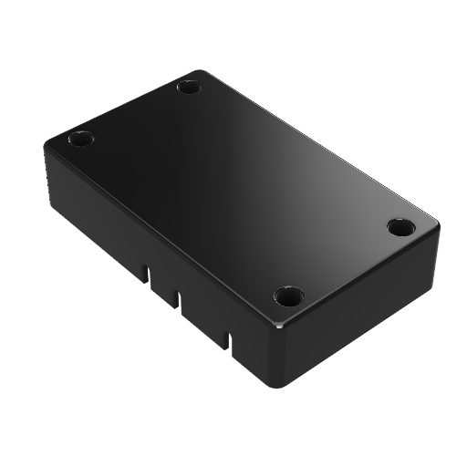
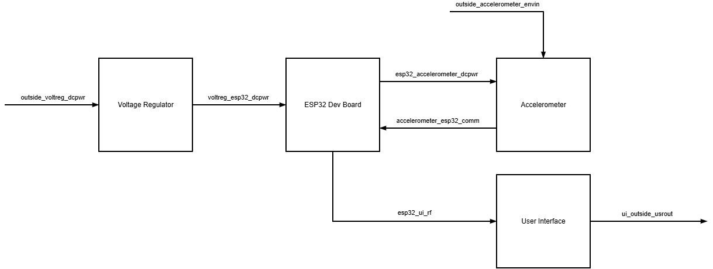
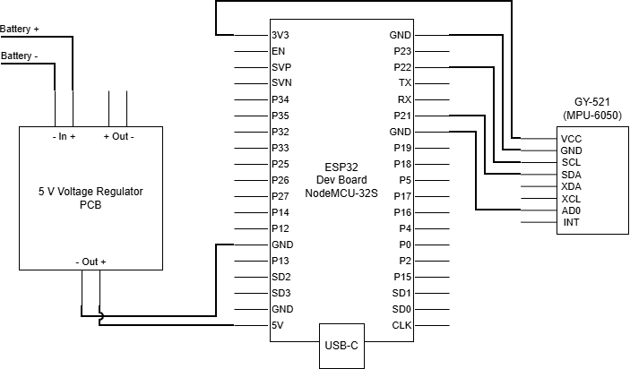

# Wireless G-Force Monitor

**ECE 341 — Junior Design Final Project | Oregon State University**  
Kadon Engle • Nolan Kessler • Wolfy Fiorini

[Web App & Live Telemetry ↓](#-web-application) • [CAD & Drawings ↓](#cad--mechanical-drawings) • [Architecture ↓](#-system-architecture)

---

A battery-powered, 2-axis wireless acceleration monitoring system built with an ESP32, MPU-6050 IMU, and a custom 5 V voltage regulator PCB. Designed to sit flat on a horizontal plane, it filters out vertical gravity and streams real-time horizontal g-force readings over Bluetooth Low Energy (BLE).

To reliably verify the 1g–3g accuracy requirement, we also built a custom stepper-driven rotational test rig and integrated both live BLE sensor telemetry and USB Serial motor control into a single browser-based web application.

| Assembled Enclosure | Internal Hardware |
| :---: | :---: |
|  |  |

---

## 📋 Engineering Requirements

1. The system must be battery operated.
2. The system must measure g-force between 1g and 3g with a margin of error no greater than ±10%.
3. The system will wirelessly transmit acceleration data to an external user interface at a minimum sample rate of 50 Hz allowing users to view and record live readings.

---

## 🛠️ Hardware & Fabrication

### Enclosure & Internals

| Battery Bay | Base Chassis |
| :---: | :---: |
|  |  |

### CAD & Mechanical Drawings

| Enclosure Base | Enclosure Lid |
| :---: | :---: |
|  |  |
| [STEP](docs/cad/enclosure-base.step) • [STL](docs/cad/enclosure-base.stl) • [Drawing (PDF)](docs/drawings/ENC-01-BASE.pdf) | [STEP](docs/cad/enclosure-lid.step) • [STL](docs/cad/enclosure-lid.stl) • [Drawing (PDF)](docs/drawings/ENC-02-LID.pdf) |

<!-- TODO: Add Test Rig Photo
### Stepper Motor Test Rig

-->

---

## 📐 System Architecture

### Block Diagram

### Wiring Diagram

---

## 🌐 Web Application

The browser-based dashboard uses the **Web Bluetooth API** to plot and record real-time acceleration data from the ESP32, and the **Web Serial API** to control the stepper test rig's RPM for live g-force verification.

🔗 **[https://kadondengle.github.io/wireless-g-force-monitor/](https://kadondengle.github.io/wireless-g-force-monitor/)**

> [!NOTE]
> The Web Bluetooth and Web Serial APIs require **Google Chrome** or **Microsoft Edge** on a Bluetooth-capable host computer, and require the physical hardware to stream live data.

Two web interfaces are hosted via the selector page:
- **Interface A** (`/wolfy`) — Hand-coded by Wolfy Fiorini.
- **Interface B** (`/kadon`) — AI-assisted, developed by Kadon Engle.